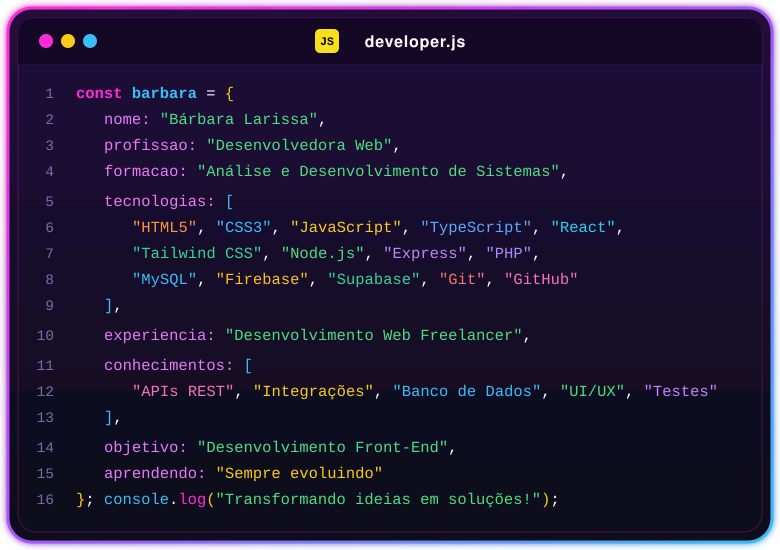
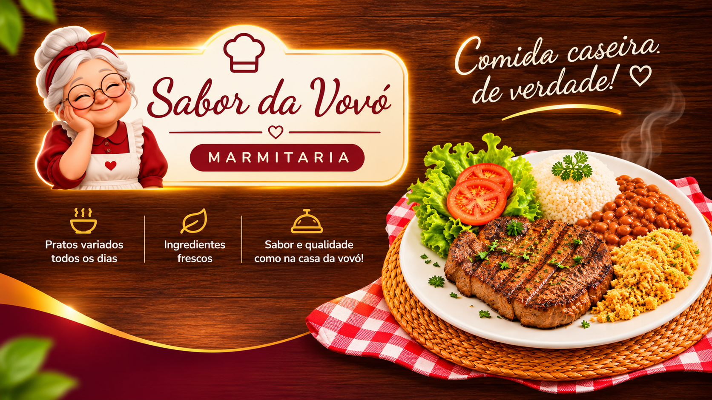

<!-- =========================================================
     BARBARA LARISSA
     FRONT-END DEVELOPER | GITHUB PROFILE
     DESIGN: BLACK / PINK / MAGENTA NEON
========================================================= -->

<!-- BANNER PRINCIPAL -->

  

<!-- NOME EM ROSA NEON -->

  

<!-- EFEITO DE DIGITAÇÃO -->

  

<!-- BOTÕES DE CONTATO -->
<table align="center" border="0" cellpadding="6" cellspacing="0">
  <tr>
    <td>
      <a href="https://www.linkedin.com/in/barbara-larissa/" target="_blank">
        <svg xmlns="http://www.w3.org/2000/svg" width="160" height="46" viewBox="0 0 160 46">
          <defs>
            <filter id="glow-li" x="-20%" y="-20%" width="140%" height="140%">
              <feGaussianBlur stdDeviation="2.5" result="b"/>
              <feMerge><feMergeNode in="b"/><feMergeNode in="SourceGraphic"/></feMerge>
            </filter>
            <linearGradient id="bg-li" x1="0" y1="0" x2="1" y2="1">
              <stop offset="0" stop-color="#281144"/>
              <stop offset="1" stop-color="#0f0b24"/>
            </linearGradient>
          </defs>
          <rect x="4" y="4" width="152" height="38" rx="19" fill="url(#bg-li)" stroke="#ff2bd6" stroke-width="2" filter="url(#glow-li)"/>
          <g transform="translate(26, 14)" fill="#ff7ae6">
            <path d="M4.5 3.2A1.7 1.7 0 1 1 2.8 1.5a1.7 1.7 0 0 1 1.7 1.7zM1.4 6.5h2.8v9H1.4zm4.7 0h2.7v1.2h.04a3 3 0 0 1 2.7-1.5c2.9 0 3.4 1.9 3.4 4.3v5h-2.8v-4.4c0-1.1 0-2.4-1.5-2.4s-1.7 1.2-1.7 2.3v4.5H6.1z"/>
          </g>
          <text x="93" y="28" font-family="'Segoe UI', Helvetica, Arial, sans-serif" font-size="13.5" font-weight="800" fill="#ffffff" text-anchor="middle" letter-spacing="1.2">LINKEDIN</text>
        </svg>
      </a>
    </td>
    <td>
      <a href="mailto:laribdev@gmail.com">
        <svg xmlns="http://www.w3.org/2000/svg" width="148" height="46" viewBox="0 0 148 46">
          <defs>
            <filter id="glow-em" x="-20%" y="-20%" width="140%" height="140%">
              <feGaussianBlur stdDeviation="2.5" result="b"/>
              <feMerge><feMergeNode in="b"/><feMergeNode in="SourceGraphic"/></feMerge>
            </filter>
            <linearGradient id="bg-em" x1="0" y1="0" x2="1" y2="1">
              <stop offset="0" stop-color="#281144"/>
              <stop offset="1" stop-color="#0f0b24"/>
            </linearGradient>
          </defs>
          <rect x="4" y="4" width="140" height="38" rx="19" fill="url(#bg-em)" stroke="#ff2bd6" stroke-width="2" filter="url(#glow-em)"/>
          <g transform="translate(26, 15)" fill="none" stroke="#ff7ae6" stroke-width="1.8" stroke-linecap="round" stroke-linejoin="round">
            <rect x="1" y="2" width="16" height="12" rx="2"/>
            <path d="M1.5 3l7.5 5.5L16.5 3"/>
          </g>
          <text x="87" y="28" font-family="'Segoe UI', Helvetica, Arial, sans-serif" font-size="13.5" font-weight="800" fill="#ffffff" text-anchor="middle" letter-spacing="1.2">EMAIL</text>
        </svg>
      </a>
    </td>
    <td>
      <a href="https://developer-portfolio-fawn-zeta.vercel.app" target="_blank">
        <svg xmlns="http://www.w3.org/2000/svg" width="166" height="46" viewBox="0 0 166 46">
          <defs>
            <filter id="glow-pf" x="-20%" y="-20%" width="140%" height="140%">
              <feGaussianBlur stdDeviation="2.5" result="b"/>
              <feMerge><feMergeNode in="b"/><feMergeNode in="SourceGraphic"/></feMerge>
            </filter>
            <linearGradient id="bg-pf" x1="0" y1="0" x2="1" y2="1">
              <stop offset="0" stop-color="#281144"/>
              <stop offset="1" stop-color="#0f0b24"/>
            </linearGradient>
          </defs>
          <rect x="4" y="4" width="158" height="38" rx="19" fill="url(#bg-pf)" stroke="#ff2bd6" stroke-width="2" filter="url(#glow-pf)"/>
          <g transform="translate(24, 14)" fill="none" stroke="#ff7ae6" stroke-width="1.8" stroke-linecap="round" stroke-linejoin="round">
            <circle cx="9" cy="9" r="7.5"/>
            <path d="M1.5 9h15M9 1.5a11.5 11.5 0 0 1 3 7.5 11.5 11.5 0 0 1-3 7.5 11.5 11.5 0 0 1-3-7.5 11.5 11.5 0 0 1 3-7.5z"/>
          </g>
          <text x="96" y="28" font-family="'Segoe UI', Helvetica, Arial, sans-serif" font-size="13.5" font-weight="800" fill="#ffffff" text-anchor="middle" letter-spacing="1.2">PORTFOLIO</text>
        </svg>
      </a>
    </td>
    <td>
      <a href="https://github.com/Barbara-larissa" target="_blank">
        <svg xmlns="http://www.w3.org/2000/svg" width="154" height="46" viewBox="0 0 154 46">
          <defs>
            <filter id="glow-gh" x="-20%" y="-20%" width="140%" height="140%">
              <feGaussianBlur stdDeviation="2.5" result="b"/>
              <feMerge><feMergeNode in="b"/><feMergeNode in="SourceGraphic"/></feMerge>
            </filter>
            <linearGradient id="bg-gh" x1="0" y1="0" x2="1" y2="1">
              <stop offset="0" stop-color="#281144"/>
              <stop offset="1" stop-color="#0f0b24"/>
            </linearGradient>
          </defs>
          <rect x="4" y="4" width="146" height="38" rx="19" fill="url(#bg-gh)" stroke="#ff2bd6" stroke-width="2" filter="url(#glow-gh)"/>
          <g transform="translate(25, 14)" fill="#ff7ae6">
            <path d="M9 1a8 8 0 0 0-2.53 15.59c.4.07.55-.17.55-.38v-1.33c-2.22.48-2.69-1.07-2.69-1.07-.36-.92-.89-1.17-.89-1.17-.73-.5.05-.49.05-.49.8.06 1.23.82 1.23.82.71 1.22 1.87.87 2.33.66.07-.52.28-.87.51-1.07-1.78-.2-3.64-.89-3.64-3.95 0-.87.31-1.59.82-2.15-.08-.2-.36-1.02.08-2.12 0 0 .67-.21 2.2.82a7.65 7.65 0 0 1 4 0c1.53-1.03 2.2-.82 2.2-.82.44 1.1.16 1.92.08 2.12.51.56.82 1.27.82 2.15 0 3.07-1.87 3.75-3.65 3.95.29.25.54.73.54 1.48v2.2c0 .21.15.46.55.38A8 8 0 0 0 9 1z"/>
          </g>
          <text x="90" y="28" font-family="'Segoe UI', Helvetica, Arial, sans-serif" font-size="13.5" font-weight="800" fill="#ffffff" text-anchor="middle" letter-spacing="1.2">GITHUB</text>
        </svg>
      </a>
    </td>
  </tr>
</table>

<!-- TAG DE LOCALIZAÇÃO -->

  <svg xmlns="http://www.w3.org/2000/svg" width="250" height="40" viewBox="0 0 250 40">
    <defs>
      <filter id="glow-loc" x="-20%" y="-20%" width="140%" height="140%">
        <feGaussianBlur stdDeviation="2.2" result="b"/>
        <feMerge><feMergeNode in="b"/><feMergeNode in="SourceGraphic"/></feMerge>
      </filter>
      <linearGradient id="bg-loc" x1="0" y1="0" x2="1" y2="1">
        <stop offset="0" stop-color="#281144"/>
        <stop offset="1" stop-color="#0f0b24"/>
      </linearGradient>
    </defs>
    <rect x="4" y="4" width="242" height="32" rx="16" fill="url(#bg-loc)" stroke="#ff2bd6" stroke-width="1.8" filter="url(#glow-loc)"/>
    <g transform="translate(22, 11)" fill="none" stroke="#ff7ae6" stroke-width="1.8" stroke-linecap="round" stroke-linejoin="round">
      <path d="M9 17s-5.5-4.3-5.5-8.5a5.5 5.5 0 1 1 11 0C14.5 12.7 9 17 9 17z"/>
      <circle cx="9" cy="8.5" r="2" fill="#ff7ae6"/>
    </g>
    <text x="136" y="24" font-family="'Segoe UI', Helvetica, Arial, sans-serif" font-size="12.5" font-weight="600" fill="#f1ecff" text-anchor="middle" letter-spacing="0.5">Londrina - Paraná - Brasil</text>
  </svg>

 

<!-- CARDS: SOBRE MIM E O QUE EU CONSTRUO (LADO A LADO) -->

<svg xmlns="http://www.w3.org/2000/svg" width="47%" viewBox="0 0 560 400" font-family="'Segoe UI', Helvetica, Arial, sans-serif">
  <defs>
    <filter id="glow" x="-20%" y="-20%" width="140%" height="140%">
      <feGaussianBlur stdDeviation="3" result="b"/>
      <feMerge><feMergeNode in="b"/><feMergeNode in="SourceGraphic"/></feMerge>
    </filter>
    <linearGradient id="bg" x1="0" y1="0" x2="0" y2="1">
      <stop offset="0" stop-color="#1c0b30"/>
      <stop offset="1" stop-color="#0d0b1e"/>
    </linearGradient>
  </defs>
  <rect x="8" y="8" width="544" height="384" rx="22" fill="url(#bg)" stroke="#ff2bd6" stroke-width="2.5" filter="url(#glow)"/>
  <rect x="16" y="16" width="528" height="368" rx="16" fill="none" stroke="#ff2bd6" stroke-opacity="0.3"/>
  <rect x="40" y="34" width="56" height="40" rx="6" fill="#1b1040" stroke="#a78bfa" stroke-width="2.5"/>
  <text x="68" y="61" font-size="18" font-weight="700" fill="#ff2bd6" text-anchor="middle" font-family="Consolas, 'Courier New', monospace">&lt;/&gt;</text>
  <path d="M32 80 H104 L98 74 H38 Z" fill="#a78bfa"/>
  <text x="120" y="68" font-size="36" font-weight="800" fill="#ffffff">Sobre <tspan fill="#ff2bd6">Mim</tspan></text>
  <rect x="120" y="82" width="110" height="3" rx="1.5" fill="#ff2bd6" filter="url(#glow)"/>
  <rect x="34" y="132" width="3" height="108" rx="1.5" fill="#ff2bd6" filter="url(#glow)"/>
  <rect x="34" y="250" width="3" height="64" rx="1.5" fill="#ff2bd6" filter="url(#glow)"/>
  <rect x="34" y="326" width="3" height="44" rx="1.5" fill="#ff2bd6" filter="url(#glow)"/>
  <g font-size="14.5" fill="#f1ecff">
    <text x="50" y="150">Sou uma Desenvolvedora Front-End focada em construir</text>
    <text x="50" y="171">interfaces modernas, funcionais e altamente responsivas.</text>
    <text x="50" y="192">Com formação técnica em Web Development, minha atuação</text>
    <text x="50" y="213">é voltada para a criação de experiências digitais que unem</text>
    <text x="50" y="234">performance técnica e um design intuitivo.</text>
    <text x="50" y="268">Tenho forte base em tecnologias como React, JavaScript (ES6+),</text>
    <text x="50" y="289">HTML5 e CSS3, o que me permite transformar protótipos em</text>
    <text x="50" y="310">aplicações reais, seguras e preparadas para o mercado.</text>
    <text x="50" y="344">Mais do que codificar, eu projeto interfaces estratégicas que</text>
    <text x="50" y="365">entregam valor real ao usuário e resultados sólidos para o negócio.</text>
  </g>
</svg>
&nbsp;&nbsp;
<svg xmlns="http://www.w3.org/2000/svg" width="47%" viewBox="0 0 560 400" font-family="'Segoe UI', Helvetica, Arial, sans-serif">
  <defs>
    <filter id="glow2" x="-20%" y="-20%" width="140%" height="140%">
      <feGaussianBlur stdDeviation="3" result="b"/>
      <feMerge><feMergeNode in="b"/><feMergeNode in="SourceGraphic"/></feMerge>
    </filter>
    <linearGradient id="bg2" x1="0" y1="0" x2="0" y2="1">
      <stop offset="0" stop-color="#1c0b30"/>
      <stop offset="1" stop-color="#0d0b1e"/>
    </linearGradient>
    <linearGradient id="ic" x1="0" y1="0" x2="1" y2="1">
      <stop offset="0" stop-color="#4b1d8f"/>
      <stop offset="1" stop-color="#8a1fa8"/>
    </linearGradient>
  </defs>
  <rect x="8" y="8" width="544" height="384" rx="22" fill="url(#bg2)" stroke="#ff2bd6" stroke-width="2.5" filter="url(#glow2)"/>
  <rect x="16" y="16" width="528" height="368" rx="16" fill="none" stroke="#ff2bd6" stroke-opacity="0.3"/>
  <rect x="38" y="30" width="58" height="58" rx="14" fill="url(#ic)" stroke="#a78bfa" stroke-opacity="0.6"/>
  <g transform="translate(67 59) rotate(45)">
    <ellipse cx="0" cy="-2" rx="8" ry="17" fill="#ffffff"/>
    <circle cx="0" cy="-6" r="4" fill="#ff2bd6"/>
    <path d="M-8 6 L-15 14 L-6 11 Z M8 6 L15 14 L6 11 Z" fill="#ff2bd6"/>
    <path d="M-4 15 Q0 28 4 15 Z" fill="#ff9d2b"/>
  </g>
  <text x="116" y="68" font-size="34" font-weight="800" fill="#ffffff">O que eu <tspan fill="#ff2bd6">construo</tspan></text>
  <rect x="116" y="82" width="110" height="3" rx="1.5" fill="#ff2bd6" filter="url(#glow2)"/>
  <g fill="#1b1040" stroke="#ff2bd6" stroke-opacity="0.8" stroke-width="1.5">
    <rect x="36" y="130" width="30" height="30" rx="6"/>
    <rect x="36" y="172" width="30" height="30" rx="6"/>
    <rect x="36" y="214" width="30" height="30" rx="6"/>
    <rect x="36" y="256" width="30" height="30" rx="6"/>
    <rect x="36" y="298" width="30" height="30" rx="6"/>
    <rect x="36" y="340" width="30" height="30" rx="6"/>
  </g>
  <g fill="none" stroke="#ff7ae6" stroke-width="1.8" stroke-linecap="round" stroke-linejoin="round">
    <rect x="42" y="136" width="18" height="12" rx="2"/>
    <path d="M51 148 V153 M46 153 H56"/>
    <path d="M51 178 L60 183 L51 188 L42 183 Z"/>
    <path d="M42 188 L51 193 L60 188"/>
    <path d="M43 238 V232 M49 238 V227 M55 238 V222 M61 238 V230"/>
    <rect x="42" y="262" width="18" height="16" rx="2"/>
    <path d="M42 267 H60"/>
    <path d="M45 316 A5 5 0 0 1 46 306 A7 7 0 0 1 59 308 A4.5 4.5 0 0 1 58 316 Z"/>
    <path d="M47 349 L42 355 L47 361 M55 349 L60 355 L55 361 M52 348 L50 362"/>
  </g>
  <g font-size="14.5" fill="#f1ecff">
    <text x="84" y="150">Interfaces ricas e responsivas utilizando React.js</text>
    <text x="84" y="192">Aplicações web focadas em UX/UI e acessibilidade</text>
    <text x="84" y="234">Dashboards e sistemas administrativos dinâmicos</text>
    <text x="84" y="276">Landing pages otimizadas para conversão e performance</text>
    <text x="84" y="318">Integrações com APIs para sistemas em tempo real</text>
    <text x="84" y="360">Código limpo, escalável e de fácil manutenção</text>
  </g>
</svg>

 

<!-- SEÇÃO TECNOLOGIAS + DEVELOPER.JS -->

  

  

  

<!-- CARD DEVELOPER.JS -->

 

<!-- PROJETOS EM DESTAQUE -->
<!-- PROJETOS EM DESTAQUE -->

<svg xmlns="http://www.w3.org/2000/svg" width="840" height="54" viewBox="0 0 840 54">
  <defs>
    <filter id="glow-proj" x="-20%" y="-50%" width="140%" height="200%">
      <feGaussianBlur stdDeviation="3" result="b"/>
      <feMerge><feMergeNode in="b"/><feMergeNode in="SourceGraphic"/></feMerge>
    </filter>
    <linearGradient id="proj-l" x1="0" y1="0" x2="1" y2="0">
      <stop offset="0" stop-color="#ff2bd6" stop-opacity="0"/>
      <stop offset="1" stop-color="#ff2bd6" stop-opacity="1"/>
    </linearGradient>
    <linearGradient id="proj-r" x1="0" y1="0" x2="1" y2="0">
      <stop offset="0" stop-color="#ff2bd6" stop-opacity="1"/>
      <stop offset="1" stop-color="#ff2bd6" stop-opacity="0"/>
    </linearGradient>
  </defs>
  <rect x="20" y="26" width="225" height="3" rx="1.5" fill="url(#proj-l)" filter="url(#glow-proj)"/>
  <g transform="translate(262, 14)" fill="none" stroke="#ff2bd6" stroke-width="2.2" stroke-linecap="round" stroke-linejoin="round" filter="url(#glow-proj)">
    <path d="M22 19a2 2 0 0 1-2 2H4a2 2 0 0 1-2-2V5a2 2 0 0 1 2-2h5l2 3h9a2 2 0 0 1 2 2z"/>
  </g>
  <text x="296" y="34" font-family="'Segoe UI', Helvetica, Arial, sans-serif" font-size="25" font-weight="800" fill="#ffffff">Projetos em <tspan fill="#ff2bd6">Destaque</tspan></text>
  <rect x="570" y="26" width="250" height="3" rx="1.5" fill="url(#proj-r)" filter="url(#glow-proj)"/>
</svg>
<table align="center" border="0" cellpadding="6" cellspacing="0">
  <tr>
    <!-- CARD 1: SABOR DA VOVÓ -->
    <td width="205" align="center" valign="top">
      
       
      <a href="https://www.sabordavovo.com/" target="_blank">
        <svg xmlns="http://www.w3.org/2000/svg" width="205" height="165" viewBox="0 0 215 175" font-family="'Segoe UI', Helvetica, Arial, sans-serif">
          <defs>
            <filter id="gp1" x="-15%" y="-15%" width="130%" height="130%">
              <feGaussianBlur stdDeviation="2.5" result="b"/>
              <feMerge><feMergeNode in="b"/><feMergeNode in="SourceGraphic"/></feMerge>
            </filter>
            <filter id="gb1" x="-25%" y="-35%" width="150%" height="170%">
              <feGaussianBlur stdDeviation="4" result="b"/>
              <feMerge><feMergeNode in="b"/><feMergeNode in="SourceGraphic"/></feMerge>
            </filter>
            <linearGradient id="bgp1" x1="0" y1="0" x2="0" y2="1">
              <stop offset="0" stop-color="#220e3b"/>
              <stop offset="1" stop-color="#0d091c"/>
            </linearGradient>
            <linearGradient id="btnp1" x1="0" y1="0" x2="1" y2="0">
              <stop offset="0" stop-color="#a21caf"/>
              <stop offset="0.5" stop-color="#ff2bd6"/>
              <stop offset="1" stop-color="#7e22ce"/>
            </linearGradient>
          </defs>
          <rect x="5" y="5" width="205" height="165" rx="18" fill="url(#bgp1)" stroke="#FF2BD6" stroke-width="2" filter="url(#gp1)"/>
          <text x="107" y="30" font-size="15" font-weight="800" fill="#ffffff" text-anchor="middle">Sabor da Vovó</text>
          <text x="107" y="47" font-size="11.5" font-weight="700" fill="#FF2BD6" text-anchor="middle">Landing Page</text>
          <text x="107" y="72" font-size="11" fill="#e9d5ff" text-anchor="middle">Marmitaria em Londrina</text>
          <text x="107" y="88" font-size="11" fill="#e9d5ff" text-anchor="middle">com pedidos via WhatsApp.</text>
          <rect x="20" y="112" width="175" height="38" rx="19" fill="url(#btnp1)" stroke="#ffffff" stroke-opacity="0.7" stroke-width="1.5" filter="url(#gb1)"/>
          <text x="107" y="136" font-size="12.5" font-weight="800" fill="#ffffff" text-anchor="middle" letter-spacing="0.4">🌐 Visitar Projeto  ›</text>
        </svg>
      </a>
    </td>
    <!-- CARD 2: 3D GUINCHOS -->
    <td width="205" align="center" valign="top">
      
       
      <a href="https://3dguinchos.com.br/" target="_blank">
        <svg xmlns="http://www.w3.org/2000/svg" width="205" height="165" viewBox="0 0 215 175" font-family="'Segoe UI', Helvetica, Arial, sans-serif">
          <defs>
            <filter id="gp2" x="-15%" y="-15%" width="130%" height="130%">
              <feGaussianBlur stdDeviation="2.5" result="b"/>
              <feMerge><feMergeNode in="b"/><feMergeNode in="SourceGraphic"/></feMerge>
            </filter>
            <filter id="gb2" x="-25%" y="-35%" width="150%" height="170%">
              <feGaussianBlur stdDeviation="4" result="b"/>
              <feMerge><feMergeNode in="b"/><feMergeNode in="SourceGraphic"/></feMerge>
            </filter>
            <linearGradient id="bgp2" x1="0" y1="0" x2="0" y2="1">
              <stop offset="0" stop-color="#220e3b"/>
              <stop offset="1" stop-color="#0d091c"/>
            </linearGradient>
            <linearGradient id="btnp2" x1="0" y1="0" x2="1" y2="0">
              <stop offset="0" stop-color="#a21caf"/>
              <stop offset="0.5" stop-color="#ff2bd6"/>
              <stop offset="1" stop-color="#7e22ce"/>
            </linearGradient>
          </defs>
          <rect x="5" y="5" width="205" height="165" rx="18" fill="url(#bgp2)" stroke="#FF2BD6" stroke-width="2" filter="url(#gp2)"/>
          <text x="107" y="30" font-size="15" font-weight="800" fill="#ffffff" text-anchor="middle">3D Guinchos</text>
          <text x="107" y="47" font-size="11.5" font-weight="700" fill="#FF2BD6" text-anchor="middle">Landing Page 24h</text>
          <text x="107" y="72" font-size="11" fill="#e9d5ff" text-anchor="middle">Otimizada para conversão</text>
          <text x="107" y="88" font-size="11" fill="#e9d5ff" text-anchor="middle">e campanhas Google Ads.</text>
          <rect x="20" y="112" width="175" height="38" rx="19" fill="url(#btnp2)" stroke="#ffffff" stroke-opacity="0.7" stroke-width="1.5" filter="url(#gb2)"/>
          <text x="107" y="136" font-size="12.5" font-weight="800" fill="#ffffff" text-anchor="middle" letter-spacing="0.4">🌐 Visitar Projeto  ›</text>
        </svg>
      </a>
    </td>
    <!-- CARD 3: FRETES EM LONDRINA -->
    <td width="205" align="center" valign="top">
      
       
      <a href="https://www.freteemlondrina.com.br/" target="_blank">
        <svg xmlns="http://www.w3.org/2000/svg" width="205" height="165" viewBox="0 0 215 175" font-family="'Segoe UI', Helvetica, Arial, sans-serif">
          <defs>
            <filter id="gp3" x="-15%" y="-15%" width="130%" height="130%">
              <feGaussianBlur stdDeviation="2.5" result="b"/>
              <feMerge><feMergeNode in="b"/><feMergeNode in="SourceGraphic"/></feMerge>
            </filter>
            <filter id="gb3" x="-25%" y="-35%" width="150%" height="170%">
              <feGaussianBlur stdDeviation="4" result="b"/>
              <feMerge><feMergeNode in="b"/><feMergeNode in="SourceGraphic"/></feMerge>
            </filter>
            <linearGradient id="bgp3" x1="0" y1="0" x2="0" y2="1">
              <stop offset="0" stop-color="#220e3b"/>
              <stop offset="1" stop-color="#0d091c"/>
            </linearGradient>
            <linearGradient id="btnp3" x1="0" y1="0" x2="1" y2="0">
              <stop offset="0" stop-color="#a21caf"/>
              <stop offset="0.5" stop-color="#ff2bd6"/>
              <stop offset="1" stop-color="#7e22ce"/>
            </linearGradient>
          </defs>
          <rect x="5" y="5" width="205" height="165" rx="18" fill="url(#bgp3)" stroke="#FF2BD6" stroke-width="2" filter="url(#gp3)"/>
          <text x="107" y="30" font-size="14.5" font-weight="800" fill="#ffffff" text-anchor="middle">Fretes em Londrina</text>
          <text x="107" y="47" font-size="11.5" font-weight="700" fill="#FF2BD6" text-anchor="middle">Landing Page</text>
          <text x="107" y="72" font-size="11" fill="#e9d5ff" text-anchor="middle">Serviços de fretes e</text>
          <text x="107" y="88" font-size="11" fill="#e9d5ff" text-anchor="middle">mudanças em Londrina.</text>
          <rect x="20" y="112" width="175" height="38" rx="19" fill="url(#btnp3)" stroke="#ffffff" stroke-opacity="0.7" stroke-width="1.5" filter="url(#gb3)"/>
          <text x="107" y="136" font-size="12.5" font-weight="800" fill="#ffffff" text-anchor="middle" letter-spacing="0.4">🌐 Visitar Projeto  ›</text>
        </svg>
      </a>
    </td>
    <!-- CARD 4: STUDIO LENA -->
    <td width="205" align="center" valign="top">
      
       
      <a href="https://studio-lena-cauassu.com.br/" target="_blank">
        <svg xmlns="http://www.w3.org/2000/svg" width="205" height="165" viewBox="0 0 215 175" font-family="'Segoe UI', Helvetica, Arial, sans-serif">
          <defs>
            <filter id="gp4" x="-15%" y="-15%" width="130%" height="130%">
              <feGaussianBlur stdDeviation="2.5" result="b"/>
              <feMerge><feMergeNode in="b"/><feMergeNode in="SourceGraphic"/></feMerge>
            </filter>
            <filter id="gb4" x="-25%" y="-35%" width="150%" height="170%">
              <feGaussianBlur stdDeviation="4" result="b"/>
              <feMerge><feMergeNode in="b"/><feMergeNode in="SourceGraphic"/></feMerge>
            </filter>
            <linearGradient id="bgp4" x1="0" y1="0" x2="0" y2="1">
              <stop offset="0" stop-color="#220e3b"/>
              <stop offset="1" stop-color="#0d091c"/>
            </linearGradient>
            <linearGradient id="btnp4" x1="0" y1="0" x2="1" y2="0">
              <stop offset="0" stop-color="#a21caf"/>
              <stop offset="0.5" stop-color="#ff2bd6"/>
              <stop offset="1" stop-color="#7e22ce"/>
            </linearGradient>
          </defs>
          <rect x="5" y="5" width="205" height="165" rx="18" fill="url(#bgp4)" stroke="#FF2BD6" stroke-width="2" filter="url(#gp4)"/>
          <text x="107" y="30" font-size="15" font-weight="800" fill="#ffffff" text-anchor="middle">Studio Lena</text>
          <text x="107" y="47" font-size="11.5" font-weight="700" fill="#FF2BD6" text-anchor="middle">Site &amp; Painel Admin</text>
          <text x="107" y="72" font-size="11" fill="#e9d5ff" text-anchor="middle">Site institucional com painel</text>
          <text x="107" y="88" font-size="11" fill="#e9d5ff" text-anchor="middle">e galeria Supabase.</text>
          <rect x="20" y="112" width="175" height="38" rx="19" fill="url(#btnp4)" stroke="#ffffff" stroke-opacity="0.7" stroke-width="1.5" filter="url(#gb4)"/>
          <text x="107" y="136" font-size="12.5" font-weight="800" fill="#ffffff" text-anchor="middle" letter-spacing="0.4">🌐 Visitar Projeto  ›</text>
        </svg>
      </a>
    </td>
  </tr>
</table>

<!-- ESTATÍSTICAS DO GITHUB -->

<!-- TÍTULO DA SEÇÃO -->
<svg xmlns="http://www.w3.org/2000/svg" width="840" height="54" viewBox="0 0 840 54">
  <defs>
    <filter id="glow-stats-title" x="-20%" y="-50%" width="140%" height="200%">
      <feGaussianBlur stdDeviation="3" result="b"/>
      <feMerge><feMergeNode in="b"/><feMergeNode in="SourceGraphic"/></feMerge>
    </filter>
    <linearGradient id="st-l" x1="0" y1="0" x2="1" y2="0">
      <stop offset="0" stop-color="#ff2bd6" stop-opacity="0"/>
      <stop offset="1" stop-color="#ff2bd6" stop-opacity="1"/>
    </linearGradient>
    <linearGradient id="st-r" x1="0" y1="0" x2="1" y2="0">
      <stop offset="0" stop-color="#ff2bd6" stop-opacity="1"/>
      <stop offset="1" stop-color="#ff2bd6" stop-opacity="0"/>
    </linearGradient>
  </defs>
  <rect x="20" y="26" width="215" height="3" rx="1.5" fill="url(#st-l)" filter="url(#glow-stats-title)"/>
  <g transform="translate(252, 14)" fill="none" stroke="#ff2bd6" stroke-width="2.2" stroke-linecap="round" stroke-linejoin="round" filter="url(#glow-stats-title)">
    <rect x="3" y="12" width="4" height="8" rx="1"/>
    <rect x="10" y="5" width="4" height="15" rx="1"/>
    <rect x="17" y="9" width="4" height="11" rx="1"/>
  </g>
  <text x="286" y="34" font-family="'Segoe UI', Helvetica, Arial, sans-serif" font-size="25" font-weight="800" fill="#ffffff">Estatísticas do <tspan fill="#ff2bd6">GitHub</tspan></text>
  <rect x="575" y="26" width="245" height="3" rx="1.5" fill="url(#st-r)" filter="url(#glow-stats-title)"/>
</svg>

 

<!-- CARDS DINÂMICOS DO PERFIL (LADO A LADO) -->
<table align="center" border="0" cellpadding="6" cellspacing="0">
  <tr>
    <td align="center">
      
    </td>
    <td align="center">
      
    </td>
  </tr>
</table>

 

<!-- SEQUÊNCIA DE CONTRIBUIÇÕES (STREAK STATS) -->

<!-- CONTATO FINAL (VAMOS CONVERSAR?) -->
<!-- BOTÕES DE CONTATO (5 BOTÕES LADO A LADO) -->
<!-- BOTÕES DE CONTATO (5 BOTÕES LADO A LADO) -->
<!-- CONTATO FINAL (VAMOS CONVERSAR?) -->

<svg xmlns="http://www.w3.org/2000/svg" width="840" height="54" viewBox="0 0 840 54">
  <defs>
    <filter id="glow-chat" x="-20%" y="-50%" width="140%" height="200%">
      <feGaussianBlur stdDeviation="3" result="b"/>
      <feMerge><feMergeNode in="b"/><feMergeNode in="SourceGraphic"/></feMerge>
    </filter>
    <linearGradient id="chat-l" x1="0" y1="0" x2="1" y2="0">
      <stop offset="0" stop-color="#ff2bd6" stop-opacity="0"/>
      <stop offset="1" stop-color="#ff2bd6" stop-opacity="1"/>
    </linearGradient>
    <linearGradient id="chat-r" x1="0" y1="0" x2="1" y2="0">
      <stop offset="0" stop-color="#ff2bd6" stop-opacity="1"/>
      <stop offset="1" stop-color="#ff2bd6" stop-opacity="0"/>
    </linearGradient>
  </defs>
  <rect x="20" y="26" width="245" height="3" rx="1.5" fill="url(#chat-l)" filter="url(#glow-chat)"/>
  <text x="420" y="34" font-family="'Segoe UI', Helvetica, Arial, sans-serif" font-size="24" font-weight="800" fill="#ffffff" text-anchor="middle">💌 Vamos <tspan fill="#ff2bd6">conversar?</tspan></text>
  <rect x="575" y="26" width="245" height="3" rx="1.5" fill="url(#chat-r)" filter="url(#glow-chat)"/>
</svg>

<table align="center" border="0" cellpadding="4" cellspacing="0">
  <tr>
    <td>
      <a href="https://www.linkedin.com/in/barbara-larissa/" target="_blank">
        <svg xmlns="http://www.w3.org/2000/svg" width="150" height="44" viewBox="0 0 150 44">
          <defs>
            <filter id="glow-li-end" x="-20%" y="-20%" width="140%" height="140%">
              <feGaussianBlur stdDeviation="2.5" result="b"/>
              <feMerge><feMergeNode in="b"/><feMergeNode in="SourceGraphic"/></feMerge>
            </filter>
            <linearGradient id="bg-li-end" x1="0" y1="0" x2="1" y2="1">
              <stop offset="0" stop-color="#281144"/>
              <stop offset="1" stop-color="#0f0b24"/>
            </linearGradient>
          </defs>
          <rect x="4" y="4" width="142" height="36" rx="18" fill="url(#bg-li-end)" stroke="#ff2bd6" stroke-width="2" filter="url(#glow-li-end)"/>
          <g transform="translate(22, 13)" fill="#ff7ae6">
            <path d="M4.5 3.2A1.7 1.7 0 1 1 2.8 1.5a1.7 1.7 0 0 1 1.7 1.7zM1.4 6.5h2.8v9H1.4zm4.7 0h2.7v1.2h.04a3 3 0 0 1 2.7-1.5c2.9 0 3.4 1.9 3.4 4.3v5h-2.8v-4.4c0-1.1 0-2.4-1.5-2.4s-1.7 1.2-1.7 2.3v4.5H6.1z"/>
          </g>
          <text x="87" y="27" font-family="'Segoe UI', Helvetica, Arial, sans-serif" font-size="13" font-weight="800" fill="#ffffff" text-anchor="middle" letter-spacing="1.1">LINKEDIN</text>
        </svg>
      </a>
    </td>
    <td>
      <a href="mailto:laribdev@gmail.com">
        <svg xmlns="http://www.w3.org/2000/svg" width="136" height="44" viewBox="0 0 136 44">
          <defs>
            <filter id="glow-em-end" x="-20%" y="-20%" width="140%" height="140%">
              <feGaussianBlur stdDeviation="2.5" result="b"/>
              <feMerge><feMergeNode in="b"/><feMergeNode in="SourceGraphic"/></feMerge>
            </filter>
            <linearGradient id="bg-em-end" x1="0" y1="0" x2="1" y2="1">
              <stop offset="0" stop-color="#281144"/>
              <stop offset="1" stop-color="#0f0b24"/>
            </linearGradient>
          </defs>
          <rect x="4" y="4" width="128" height="36" rx="18" fill="url(#bg-em-end)" stroke="#ff2bd6" stroke-width="2" filter="url(#glow-em-end)"/>
          <g transform="translate(22, 14)" fill="none" stroke="#ff7ae6" stroke-width="1.8" stroke-linecap="round" stroke-linejoin="round">
            <rect x="1" y="2" width="16" height="12" rx="2"/>
            <path d="M1.5 3l7.5 5.5L16.5 3"/>
          </g>
          <text x="80" y="27" font-family="'Segoe UI', Helvetica, Arial, sans-serif" font-size="13" font-weight="800" fill="#ffffff" text-anchor="middle" letter-spacing="1.1">EMAIL</text>
        </svg>
      </a>
    </td>
    <td>
      <a href="https://wa.me/5543996818242" target="_blank">
        <svg xmlns="http://www.w3.org/2000/svg" width="158" height="44" viewBox="0 0 158 44">
          <defs>
            <filter id="glow-wa-end" x="-20%" y="-20%" width="140%" height="140%">
              <feGaussianBlur stdDeviation="2.5" result="b"/>
              <feMerge><feMergeNode in="b"/><feMergeNode in="SourceGraphic"/></feMerge>
            </filter>
            <linearGradient id="bg-wa-end" x1="0" y1="0" x2="1" y2="1">
              <stop offset="0" stop-color="#281144"/>
              <stop offset="1" stop-color="#0f0b24"/>
            </linearGradient>
          </defs>
          <rect x="4" y="4" width="150" height="36" rx="18" fill="url(#bg-wa-end)" stroke="#34d399" stroke-width="2" filter="url(#glow-wa-end)"/>
          <g transform="translate(21, 13)" fill="none" stroke="#34d399" stroke-width="1.8" stroke-linecap="round" stroke-linejoin="round">
            <path d="M16 11.5a7 7 0 0 1-10.3 6.2L2 18.5l.8-3.7A7 7 0 1 1 16 11.5z"/>
          </g>
          <text x="92" y="27" font-family="'Segoe UI', Helvetica, Arial, sans-serif" font-size="13" font-weight="800" fill="#ffffff" text-anchor="middle" letter-spacing="1.1">WHATSAPP</text>
        </svg>
      </a>
    </td>
    <td>
      <a href="https://developer-portfolio-fawn-zeta.vercel.app" target="_blank">
        <svg xmlns="http://www.w3.org/2000/svg" width="156" height="44" viewBox="0 0 156 44">
          <defs>
            <filter id="glow-pf-end" x="-20%" y="-20%" width="140%" height="140%">
              <feGaussianBlur stdDeviation="2.5" result="b"/>
              <feMerge><feMergeNode in="b"/><feMergeNode in="SourceGraphic"/></feMerge>
            </filter>
            <linearGradient id="bg-pf-end" x1="0" y1="0" x2="1" y2="1">
              <stop offset="0" stop-color="#281144"/>
              <stop offset="1" stop-color="#0f0b24"/>
            </linearGradient>
          </defs>
          <rect x="4" y="4" width="148" height="36" rx="18" fill="url(#bg-pf-end)" stroke="#ff2bd6" stroke-width="2" filter="url(#glow-pf-end)"/>
          <g transform="translate(21, 13)" fill="none" stroke="#ff7ae6" stroke-width="1.8" stroke-linecap="round" stroke-linejoin="round">
            <circle cx="9" cy="9" r="7.5"/>
            <path d="M1.5 9h15M9 1.5a11.5 11.5 0 0 1 3 7.5 11.5 11.5 0 0 1-3 7.5 11.5 11.5 0 0 1-3-7.5 11.5 11.5 0 0 1 3-7.5z"/>
          </g>
          <text x="90" y="27" font-family="'Segoe UI', Helvetica, Arial, sans-serif" font-size="13" font-weight="800" fill="#ffffff" text-anchor="middle" letter-spacing="1.1">PORTFOLIO</text>
        </svg>
      </a>
    </td>
    <td>
      <a href="https://github.com/Barbara-larissa" target="_blank">
        <svg xmlns="http://www.w3.org/2000/svg" width="144" height="44" viewBox="0 0 144 44">
          <defs>
            <filter id="glow-gh-end" x="-20%" y="-20%" width="140%" height="140%">
              <feGaussianBlur stdDeviation="2.5" result="b"/>
              <feMerge><feMergeNode in="b"/><feMergeNode in="SourceGraphic"/></feMerge>
            </filter>
            <linearGradient id="bg-gh-end" x1="0" y1="0" x2="1" y2="1">
              <stop offset="0" stop-color="#281144"/>
              <stop offset="1" stop-color="#0f0b24"/>
            </linearGradient>
          </defs>
          <rect x="4" y="4" width="136" height="36" rx="18" fill="url(#bg-gh-end)" stroke="#ff2bd6" stroke-width="2" filter="url(#glow-gh-end)"/>
          <g transform="translate(21, 13)" fill="#ff7ae6">
            <path d="M9 1a8 8 0 0 0-2.53 15.59c.4.07.55-.17.55-.38v-1.33c-2.22.48-2.69-1.07-2.69-1.07-.36-.92-.89-1.17-.89-1.17-.73-.5.05-.49.05-.49.8.06 1.23.82 1.23.82.71 1.22 1.87.87 2.33.66.07-.52.28-.87.51-1.07-1.78-.2-3.64-.89-3.64-3.95 0-.87.31-1.59.82-2.15-.08-.2-.36-1.02.08-2.12 0 0 .67-.21 2.2.82a7.65 7.65 0 0 1 4 0c1.53-1.03 2.2-.82 2.2-.82.44 1.1.16 1.92.08 2.12.51.56.82 1.27.82 2.15 0 3.07-1.87 3.75-3.65 3.95.29.25.54.73.54 1.48v2.2c0 .21.15.46.55.38A8 8 0 0 0 9 1z"/>
          </g>
          <text x="84" y="27" font-family="'Segoe UI', Helvetica, Arial, sans-serif" font-size="13" font-weight="800" fill="#ffffff" text-anchor="middle" letter-spacing="1.1">GITHUB</text>
        </svg>
      </a>
    </td>
  </tr>
</table>

 

<!-- ASSINATURA E ONDA FINAL -->
<!-- ASSINATURA FINAL EM CÓDIGO (100% COMPATÍVEL COM GITHUB) -->

  <svg xmlns="http://www.w3.org/2000/svg" width="100%" viewBox="0 0 820 84" font-family="'Segoe UI', Helvetica, Arial, sans-serif">
    <rect x="140" y="6" width="540" height="2" rx="1" fill="#ff2bd6" opacity="0.6"/>
    <text x="410" y="40" font-size="18.5" font-weight="800" fill="#ffffff" text-anchor="middle">Construindo o futuro da web com foco em <tspan fill="#ff7ae6">qualidade</tspan> e <tspan fill="#ff7ae6">experiência.</tspan> <tspan fill="#ff2bd6">♡</tspan></text>
    <text x="410" y="66" font-size="11.5" font-weight="700" fill="#c4b5fd" text-anchor="middle" letter-spacing="2.2">DESENVOLVIMENTO <tspan fill="#ff2bd6">•</tspan> TECNOLOGIA <tspan fill="#ff2bd6">•</tspan> CRIATIVIDADE <tspan fill="#ff2bd6">•</tspan> EVOLUÇÃO</text>
  </svg>

  

